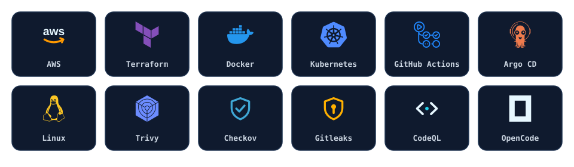
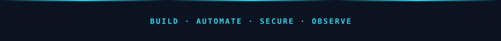

<div align="center">


<br/>

[](https://harikrish-portfolio25.web.app/)
[](https://www.linkedin.com/in/hari-krish-13300b27a/)
[](https://github.com/Harikrishna2525)

<br/>

*Building and automating cloud infrastructure, CI/CD pipelines, containerized environments, and secure deployment workflows.*

</div>

---

## AWS Infrastructure & DevOps Engineer

I specialize in **AWS cloud infrastructure, Terraform-based automation, containerized workloads, and secure CI/CD**. I turn manual cloud setup into repeatable infrastructure code, then validate it with health checks, pipeline automation, and security scanning.

My work is focused on:

- **Infrastructure as Code** — AWS networking, compute, load balancing, and state management with Terraform
- **Delivery automation** — GitHub Actions workflows, container image publishing, and GitHub OIDC authentication to AWS
- **Container platforms** — Docker workloads and Kubernetes fundamentals, including pod-level troubleshooting
- **DevSecOps** — secret detection, static analysis, image scanning, IaC scanning, and least-privilege access
- **Operations** — Linux, networking, load balancing, health checks, and failure-oriented debugging

| | |
|---|---|
| **Core focus** | AWS Infrastructure · Terraform · CI/CD · Containers · DevSecOps |
| **Engineering approach** | Provision with Terraform · containerize with Docker · automate with GitHub Actions · secure with least privilege and scanning |
| **Open to** | Full-time / remote AWS Infrastructure, DevOps, and Platform Engineering roles |

---

## Technical Stack

<div align="center">



</div>

| Area | Technologies |
|:--|:--|
| **Cloud Infrastructure** | `AWS` · `EC2` · `VPC` · `ALB` · `Auto Scaling Groups` · `S3` · `CloudFront` · `IAM` · `Lambda` · `API Gateway` · `DynamoDB` · `CloudWatch` |
| **Infrastructure as Code** | `Terraform` · `S3 backend / remote state` · `S3 native locking (use_lockfile = true)` · `Terraform modules` · `Infrastructure provisioning` |
| **Containers & Orchestration** | `Docker` · `Kubernetes` · `GHCR` · `kubectl` |
| **CI/CD & GitOps** | `GitHub Actions` · `GitHub OIDC` · `Argo CD` |
| **DevSecOps & Security** | `Trivy` · `Checkov` · `Gitleaks` · `CodeQL` · `IAM least privilege` · `Secrets management` |
| **Operating Systems & Networking** | `Linux / Ubuntu` · `Git` · `DNS` · `TCP/IP` · `HTTP/HTTPS` · `Security Groups` · `Load balancing` |
| **AI-Assisted DevOps** | `OpenCode` · `Terminal-based AI coding agents` · `Infrastructure configuration review` · `CI/CD troubleshooting` · `Kubernetes configuration analysis` · `AI-assisted code review` |

> **Scope:** Kubernetes experience is lab-based on a local Docker Desktop cluster. Argo CD is part of my GitOps practice; no production EKS experience is claimed.

---

## Featured Projects

### 01 — Auto-Healing AWS Infrastructure

> `AWS` · `Terraform` · `ALB` · `ASG` · `EC2` · `Docker` · `GitHub Actions`

A multi-AZ AWS environment with an Application Load Balancer, target-group health checks, and an Auto Scaling Group configured with ELB health checks. A Dockerized application is bootstrapped automatically on new instances through EC2 user data.

**Highlights**

- VPC with two public subnets across Availability Zones.
- Application Load Balancer forwarding traffic to a target group.
- Auto Scaling Group using `health_check_type = "ELB"` and CPU target tracking.
- Dockerized application started through EC2 user data.
- Terraform provisioning and a GitHub Actions workflow for Terraform plan/validate.
- Instance-termination and container-failure scenarios documented after manual testing.

**Scope:** ALB target-group and ASG health checks are configured; CloudWatch alarms are not part of the current implementation. The EC2 user data pulls the application image from Docker Hub; GHCR publishing is covered in Project 03.

**Repositories**

- [`Aws-ALB-ASG-auto-healing`](https://github.com/Harikrishna2525/Aws-ALB-ASG-auto-healing) — architecture, Docker image, user data, failure testing
- [`Infra-High-Availability`](https://github.com/Harikrishna2525/Infra-High-Availability) — Terraform implementation of the VPC, ALB, ASG, and EC2 layer

### 02 — Terraform AWS Infrastructure

> `Terraform` · `AWS` · `VPC` · `EC2` · `ALB` · `ASG` · `S3` · `CloudFront`

Terraform-defined AWS networking and compute with remote state in S3. The HA infrastructure repository uses native S3 state locking via `use_lockfile = true`; a companion repository adds private S3 + CloudFront static delivery.

**Highlights**

- VPC, public subnets, route tables, internet gateway, and security groups.
- EC2 launch template and Auto Scaling Group.
- S3 remote state with `use_lockfile = true`; no DynamoDB lock table in this backend.
- IAM instance profile attached to the launch template.
- Private S3 origin with CloudFront Origin Access Control (`terraform-personal-resources`).
- Terraform plan/validate workflow through GitHub Actions.

**State-locking note:** `use_lockfile = true` is implemented in `Infra-High-Availability`. The companion `terraform-personal-resources` repository uses DynamoDB locking for its own state.

**Repositories**

- [`Infra-High-Availability`](https://github.com/Harikrishna2525/Infra-High-Availability) — VPC, subnets, ALB, ASG, EC2, S3 backend with native locking
- [`terraform-personal-resources`](https://github.com/Harikrishna2525/terraform-personal-resources) — private S3 + CloudFront/OAC

### 03 — Secure DevSecOps CI/CD Pipeline

> `GitHub Actions` · `Docker` · `GHCR` · `Gitleaks` · `CodeQL` · `Trivy` · `Checkov`

A GitHub Actions pipeline that scans source, builds a Docker image, and publishes it to GitHub Container Registry. The workflow separates enforced CI jobs from local or currently disabled checks.

**Pipeline**

```text
Gitleaks ──▶ CodeQL ──▶ Docker build ──▶ GHCR
```

| Control | Status |
|:--|:--|
| Gitleaks secret detection | CI job — runs before CodeQL (`needs`) |
| CodeQL static analysis (`security-extended`) | CI job — runs before image publish (`needs`) |
| Docker build + GHCR publish (SHA + `latest`) | CI job |
| Trivy image scan | Step defined, currently commented out — not an enforced gate |
| Checkov IaC scan | Local review — not wired into this CI pipeline |
| GitHub OIDC to AWS | Implemented in the separate Terraform workflow |
| Automated rollback | Not implemented |

**Repositories**

- [`Docker-nextjs-app`](https://github.com/Harikrishna2525/Docker-nextjs-app) — Gitleaks, CodeQL, Docker build, GHCR publish
- [`Infra-High-Availability`](https://github.com/Harikrishna2525/Infra-High-Availability) — GitHub OIDC authentication to AWS for Terraform

### 04 — Kubernetes & GitOps

> `Kubernetes` · `Docker Desktop` · `kubectl` · `Argo CD`

Kubernetes deployment practice on a local Docker Desktop cluster, covering Deployments, ReplicaSets, Services, ConfigMaps, Secrets, scaling, rolling updates, and pod-level troubleshooting.

**Highlights**

- Deployment with 5 replicas and a NodePort Service.
- ConfigMap and Secret injection into pods.
- Deployment-based rolling updates.
- Troubleshooting `CrashLoopBackOff` and `ImagePullBackOff` with `kubectl get`, `describe`, and `logs`.
- GitOps workflow concepts with Argo CD.

**Scope:** local Docker Desktop cluster; no production EKS experience is claimed. These public repositories contain Kubernetes manifests, not Argo CD application manifests.

**Repositories**

- [`k8s-clusters`](https://github.com/Harikrishna2525/k8s-clusters) — Deployment, Service, ConfigMap, Secret, replicas
- [`Docker-nextjs-app`](https://github.com/Harikrishna2525/Docker-nextjs-app) — Kubernetes Deployment and Service for the containerized app

---

## AI-Assisted DevOps Engineering

I use **OpenCode** as a terminal-based AI coding agent in my daily workflow. It is a tool I use, not an AI agent I developed.

Typical uses:

- Analyzing and reviewing Terraform configurations
- Troubleshooting AWS infrastructure and networking issues
- Debugging Docker and Kubernetes workloads
- Reviewing GitHub Actions pipeline behavior
- Interpreting DevSecOps scan reports
- AI-assisted code review and configuration review
- Improving infrastructure documentation

AI-assisted output is treated as a draft: I review, validate, and test changes before applying them.

---

## GitHub Activity

<div align="center">

[](https://github.com/Harikrishna2525)

<sub>Live GitHub data — public repositories and contribution activity.</sub>

</div>

---

## Open to Work

| | |
|---|---|
| **Role focus** | AWS Infrastructure · DevOps · Platform Engineering |
| **Work type** | Full-time / Remote |
| **Portfolio** | [harikrish-portfolio25.web.app](https://harikrish-portfolio25.web.app/) |
| **LinkedIn** | [linkedin.com/in/hari-krish-13300b27a](https://www.linkedin.com/in/hari-krish-13300b27a/) |
| **GitHub** | [github.com/Harikrishna2525](https://github.com/Harikrishna2525) |

---

<div align="center">



</div>